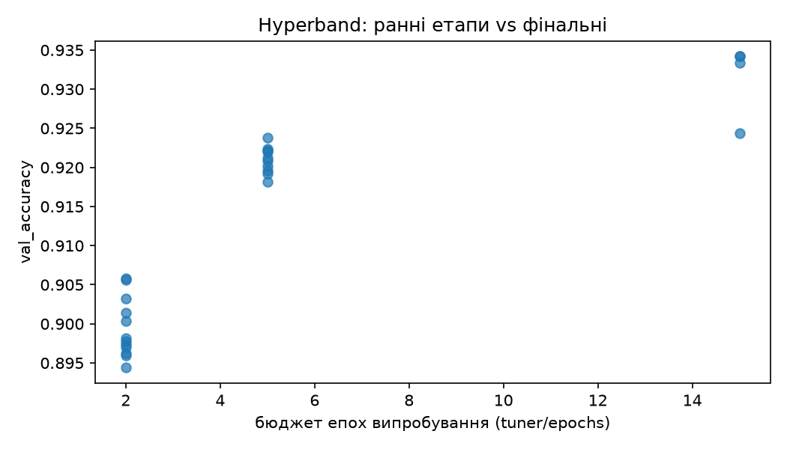
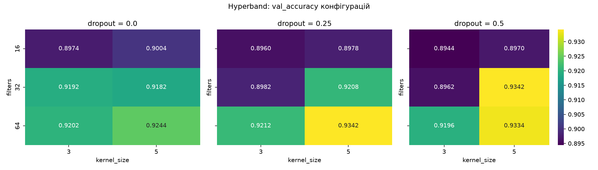

# Пункт 5. Аналіз результатів KerasTuner

Показник у всіх таблицях - val_accuracy на валідаційній вибірці (5 000 зображень).
Тестова вибірка тут не використовується.

## Найкращі конфігурації

**Hyperband** (за найбільшим бюджетом, до якого дійшла конфігурація):

| filters | kernel | dropout | Бюджет, епох | val acc |
|---|---|---|---|---|
| 32 | 5 | 0,5 | 15 | 0,9342 |
| 64 | 5 | 0,25 | 15 | 0,9342 |
| 64 | 5 | 0,5 | 15 | 0,9334 |
| 64 | 5 | 0,0 | 15 | 0,9244 |

**RandomSearch** (7 випробувань, максимальний бюджет — до 15 епох на кожне, з EarlyStopping):

| filters | kernel | dropout | val acc |
|---|---|---|---|
| 64 | 3 | 0,5 | 0,9342 |
| 32 | 3 | 0,5 | 0,9334 |
| 16 | 3 | 0,5 | 0,9326 |
| 32 | 3 | 0,25 | 0,9324 |
| 16 | 5 | 0,25 | 0,9298 |
| 64 | 5 | 0,0 | 0,9236 |
| 16 | 5 | 0,0 | 0,9214 |

Hyperband вибрав (filters = 32, kernel = 5, dropout = 0,5), RandomSearch -
(64, 3, 0,5). Валідаційна точність обох однакова (0,9342). У Hyperband дві конфігурації
мали рівний результат (0,9342): обрано першу за порядком, а друга (64, 5, 0,25) має
305 546 параметрів проти 253 514, тож вибір ґрунтується на рівності, а не на перевазі.

## Що відсіяв Hyperband

| filters | kernel | dropout | 2 епохи | 5 епох | 15 епох | Доля |
|---|---|---|---|---|---|---|
| 32 | 5 | 0,5 | - | 0,9222 | 0,9342 | дійшла до кінця |
| 64 | 5 | 0,25 | - | 0,9220 | 0,9342 | дійшла до кінця |
| 64 | 5 | 0,5 | 0,9032 | 0,9238 | 0,9334 | дійшла до кінця |
| 64 | 5 | 0,0 | 0,9058 | 0,9224 | 0,9244 | дійшла до кінця |
| 64 | 3 | 0,5 | 0,9056 | 0,9196 | - | відсіяна після 5 епох |
| 64 | 3 | 0,25 | - | 0,9212 | - | відсіяна після 5 епох |
| 64 | 3 | 0,0 | 0,9014 | 0,9202 | - | відсіяна після 5 епох |
| 32 | 5 | 0,25 | - | 0,9208 | - | відсіяна після 5 епох |
| 32 | 5 | 0,0 | - | 0,9182 | - | відсіяна після 5 епох |
| 32 | 3 | 0,0 | - | 0,9192 | - | відсіяна після 5 епох |
| 32 | 3 | 0,25 | 0,8982 | - | - | відсіяна після 2 епох |
| 32 | 3 | 0,5 | 0,8962 | - | - | відсіяна після 2 епох |
| 16 | 5 | 0,0 | 0,9004 | - | - | відсіяна після 2 епох |
| 16 | 5 | 0,25 | 0,8978 | - | - | відсіяна після 2 епох |
| 16 | 5 | 0,5 | 0,8970 | - | - | відсіяна після 2 епох |
| 16 | 3 | 0,0 | 0,8974 | - | - | відсіяна після 2 епох |
| 16 | 3 | 0,25 | 0,8960 | - | - | відсіяна після 2 епох |
| 16 | 3 | 0,5 | 0,8944 | - | - | відсіяна після 2 епох |

Прочерк означає, що конфігурація на цьому щаблі не навчалась. Підсумок: після 2 епох
відсіяно 8 конфігурацій, після 5 епох ще 6, до 15 епох дійшли 4.

На рисунку на кожному бюджеті показано різні конфігурації, тому він ілюструє зростання
val_accuracy з бюджетом (0,894-0,906 → 0,918-0,924 → 0,924-0,934), а не зміну рангів
однієї й тієї ж конфігурації. Зміну рангів видно в таблиці вище.

**Увага до теплової карти:** кожна клітинка показує результат при *максимальному бюджеті,
до якого дійшла конфігурація* (2, 5 або 15 епох). Клітинки з різним бюджетом не можна
порівнювати між собою: наприклад, значення 0,89-0,90 для 16 фільтрів отримані після 2 епох.

## Висновки

**Головний чинник - Dropout.** Конфігурації з dropout ≥ 0,25, які отримали бюджет до 15 епох, дали
0,9298-0,9342, а з dropout = 0,0 - лише 0,9214-0,9244 (Hyperband: 64/5/0,0 - 0,9244;
RandomSearch: 64/5/0,0 - 0,9236, 16/5/0,0 - 0,9214). Різниця близько 1 п. п. значно перевищує
розкид між кращими конфігураціями (до 0,2 п. п.). Фільтри й ядро другорядні: чотири кращі
випробування RandomSearch (0,9342, 0,9334, 0,9326, 0,9324) мають ядро 3, а кількість фільтрів
16, 32 або 64 майже не змінює результат, якщо Dropout увімкнений.

**Що відсіяв Hyperband.** Після 2 епох випали всі шість конфігурацій із 16 фільтрами та дві
з 32 фільтрами й ядром 3 (0,8944-0,9004), далі пройшли чотири конфігурації з 64 фільтрами
(0,9014-0,9058). Після 5 епох відсіяно ще шість, зокрема всі три конфігурації з 64 фільтрами й ядром 3.
У підсумку жодна конфігурація з ядром 3 не перейшла на етап із бюджетом до 15 епох.

**Чому високий проміжний результат не гарантує найкращої якості.**
1. Конфігурація 64/5/0,0 після 2 епох була найкращою з 12 (0,9058), а після повного навчання
   досягла лише 0,9244. Її аналог із Dropout 0,5 (64/5/0,5) на 2-й епосі мав 0,9032, тобто
   був гіршим, але фінально дав 0,9334 (різниця 0,9 п. п. на користь конфігурації, яка на
   початку програвала). Dropout уповільнює швидкий початок навчання, але зменшує перенавчання
   пізніше, тому короткий бюджет несправедливий до сильно регуляризованих моделей.
2. Конфігурації 32/3/0,5 та 16/3/0,5 Hyperband відсіяв після 2 епох із найгіршими показниками
   (0,8962 і 0,8944). Тим часом у RandomSearch за повного навчання вони дали 0,9334 і 0,9326,
   що майже дорівнює переможцю Hyperband (0,9342). Тобто раннє відсіювання прибрало цілий
   клас конфігурацій, які за повного навчання були не гірші.
3. Частина відсіювань потрапляє в межу шуму. Стандартна похибка val acc на 5 000 зображень
   становить близько 0,36 п. п., а відрив між останньою пройшовшою й найкращою відсіяною
   конфігурацією дорівнював 0,10 п. п. (2 епохи, 0,9014 проти 0,9004) і 0,08 п. п. (5 епох,
   0,9220 проти 0,9212). Це 4-5 зображень, тож такі рішення фактично випадкові.

**Порівняння методів.** Обидва методи дійшли до однакового val acc (0,9342), але різних
конфігурацій; різниця між кількома кращими конфігураціями не перевищує шуму, тому «найкраща»
конфігурація визначена умовно, а не однозначно. Hyperband виділив бюджет до 15 епох для 4 конфігурацій, а RandomSearch — для всіх 7 випробувань. При цьому через EarlyStopping фактична тривалість навчання окремих конфігурацій могла бути меншою за 15 епох.

**Обмеження.** Кожну конфігурацію навчали один раз. Повторне навчання переможця Hyperband у п. 6 дало val_accuracy 0,9318 замість 0,9342 — різниця становить 0,24 відсоткового пункта. Це демонструє, що результати окремого запуску можуть дещо відрізнятися.