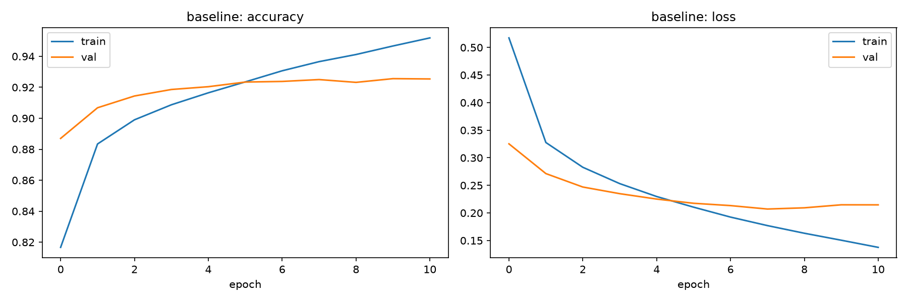
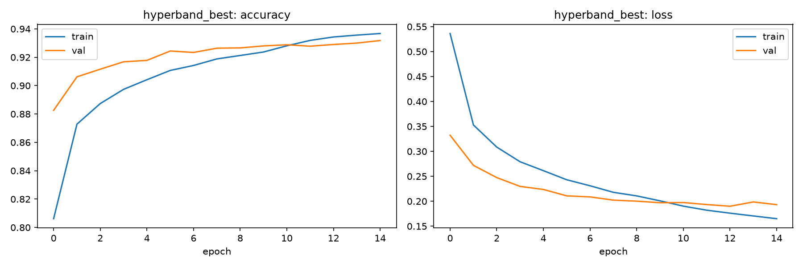

# Пункт 6. Повторне навчання відібраних моделей

Відібрані конфігурації навчено повторно на тій самій навчальній вибірці (55 000 зображень) за однакових умов: оптимізатор Adam з коефіцієнтом навчання 0.001, розмір пакета 128, функція втрат sparse_categorical_crossentropy, seed = 42. Максимальна кількість епох становила 15. Для запобігання перенавчанню застосовувався EarlyStopping із моніторингом val_loss, patience = 3 та restore_best_weights = True. Це означає, що навчання зупинялося, якщо значення val_loss не покращувалося протягом трьох послідовних епох, після чого відновлювалися ваги з епохи з найменшим значенням val_loss.

| Модель | Конфігурація (filters / kernel / dropout) | Параметрів | Епох | Best val acc | Min val loss (епоха) | Train acc (остання епоха) | Розрив train-val | Час, с |
|---|---|---|---|---|---|---|---|---|
| baseline | 32 / 3 / 0,0 | 220 234 | 11 | 0,9256 | 0,2071 (8) | 0,9519 | 0,0265 | 122,9 |
| hyperband_best | 32 / 5 / 0,5 | 253 514 | 15 | 0,9318 | 0,1900 (13) | 0,9367 | 0,0049 | 245,1 |
| random_best | 64 / 3 / 0,5 | 238 986 | 15 | 0,9342 | 0,1864 (15) | 0,9376 | 0,0036 | 244,3 |

Епохи нумеруються з 1. «Розрив train-val» - різниця train acc і val acc на останній епосі.
Train acc виміряно з увімкненим Dropout, тому розрив для моделей з Dropout занижений.

<!-- додати ../results/b_random_best_history.png, якщо він збережений -->

## Висновки

**Базова модель перенавчається.** Val loss мінімальний на 8-й епосі (0,207) і далі зростає
(0,215 на 10-11-й епосі), тоді як train acc продовжує рости до 95,2 %. Розрив train-val
на кінець навчання 2,7 п. п. Рання зупинка спрацювала на 11-й епосі й повернула ваги 8-ї.

**Моделі з Dropout 0,5 перенавчаються значно менше.** Розрив train-val у них 0,4-0,5 п. п.
замість 2,7 п. п. Мінімум val loss досягається пізно (13-та й 15-та епохи), а рання зупинка
не спрацювала: навчання обмежив бюджет у 15 епох, а не перенавчання. Цілком можливо, що
довше навчання дало б ще невеликий приріст, але такий запуск не виконувався.

**Відтворюваність.** Конфігурація 32 / 5 / 0,5 під час пошуку мала val acc 0,9342, а після
повторного навчання - 0,9318 (різниця 0,24 п. п.). Це показує, що різниця між «найкращими»
конфігураціями пошуку, які розрізняються на 0,1-0,2 п. п., лежить у межах шуму одного запуску.

**Примітка про val acc.** У таблиці наведено найкращий val acc за всю історію навчання, а ваги
для тесту обираються за мінімальним val loss, тому для hyperband_best (мінімум val loss на 13-й
епосі, а найкращий val acc на 15-й) ці епохи не збігаються.
