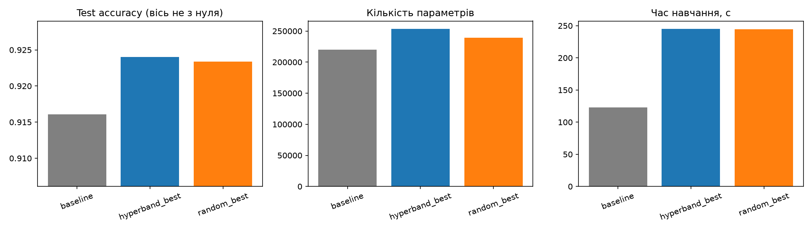
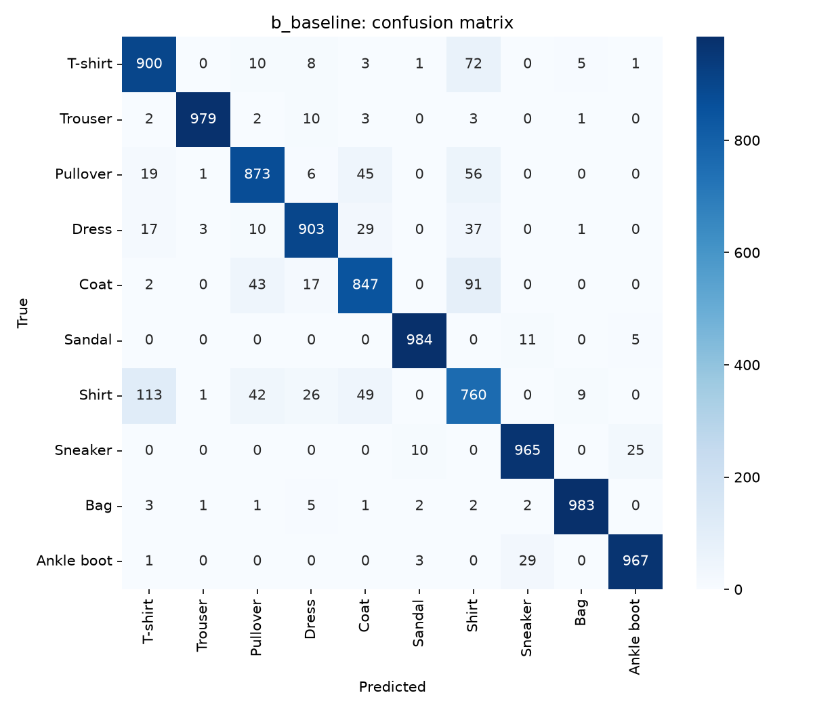
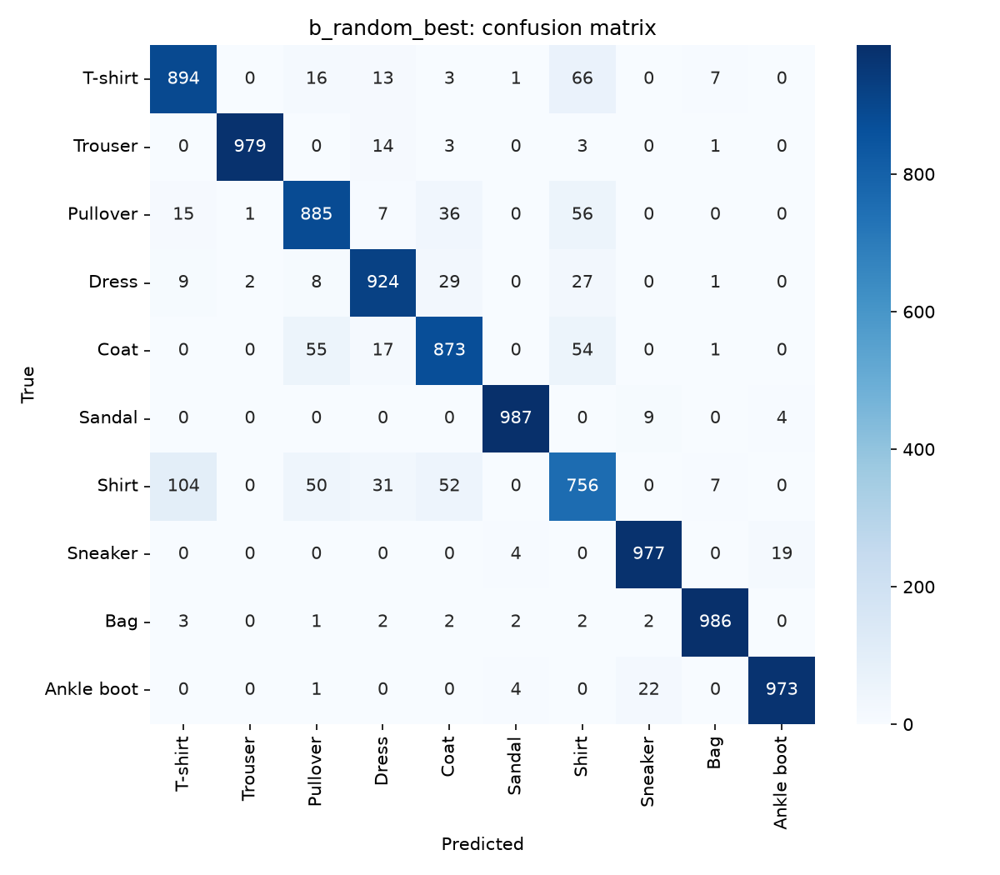

# Пункт 7. Порівняння з базовою CNN

Усі три моделі оцінено на одній тестовій вибірці (10 000 зображень) після завершення вибору
конфігурацій. Базова модель цього пункту - з ранньою зупинкою (11 епох), тому її тестова точність
(91,61 %) відрізняється від базової з п. 4 без ранньої зупинки (90,51 %); порівнювати треба
лише в межах цієї таблиці.

| Модель | Конфігурація | Параметрів | Епох | Час навчання, с | Test acc | Test loss | Помилок із 10 000 | Macro F1 |
|---|---|---|---|---|---|---|---|---|
| baseline | 32 / 3 / 0,0 | 220 234 | 11 | 122,9 | 0,9161 | 0,2330 | 839 | 0,916 |
| hyperband_best | 32 / 5 / 0,5 | 253 514 | 15 | 245,1 | 0,9240 | 0,2151 | 760 | 0,924 |
| random_best | 64 / 3 / 0,5 | 238 986 | 15 | 244,3 | 0,9234 | 0,2171 | 766 | 0,923 |

Вісь Test accuracy на рисунку починається не з нуля, тому візуально різниця перебільшена.

## Вартість пошуку

| Метод | Час пошуку, с | Повторне навчання, с | Разом, с (хв) | У скільки разів більше за базову |
|---|---|---|---|---|
| Hyperband | 2140,0 | 245,1 | 2385,1 (39,8) | 19,4 |
| RandomSearch | 1148,3 | 244,3 | 1392,6 (23,2) | 11,3 |

Базова модель навчалась 122,9 с. Параметрів у кращих моделей більше на 15,1 % (Hyperband)
і 8,5 % (RandomSearch).

## Матриці помилок

F1 за класами:

| Клас | baseline | hyperband_best | random_best |
|---|---|---|---|
| T-shirt | 0,875 | 0,883 | 0,883 |
| Trouser | 0,986 | 0,990 | 0,988 |
| Pullover | 0,881 | 0,878 | 0,878 |
| Dress | 0,914 | 0,926 | 0,920 |
| Coat | 0,857 | 0,864 | 0,874 |
| Sandal | 0,984 | 0,985 | 0,988 |
| Shirt | 0,752 | 0,775 | 0,770 |
| Sneaker | 0,962 | 0,975 | 0,972 |
| Bag | 0,983 | 0,986 | 0,985 |
| Ankle boot | 0,968 | 0,976 | 0,975 |

## Висновки

**Якість.** Обидві знайдені моделі показали кращі результати порівняно з базовою CNN: test accuracy зросла з 91,61 % до 92,40 % для Hyperband (+0,79 відсоткового пункта) і до 92,34 % для RandomSearch (+0,73 відсоткового пункта). Test loss знизився з 0,233 до 0,215 і 0,217 відповідно, а кількість помилок скоротилася на 79 і 73 зображення. Різниця між моделями Hyperband і RandomSearch становить лише 0,06 відсоткового пункта (6 зображень), тобто за отриманими результатами їхня якість практично однакова. Для підтвердження статистичної значущості різниці потрібен додатковий парний статистичний тест.

**Де саме приріст.** Найбільше покращились Dress (+39 правильних відповідей у Hyperband),
Shirt (+19) і Sneaker (+10); Coat→Shirt плутається рідше (91 → 66 і 54). Клас Shirt
лишається найгіршим (F1 0,752 → 0,775 і 0,770), а пара T-shirt/Shirt - головним джерелом
помилок (185 перемішувань у базової моделі, 176 і 170 у тюнінгових): підбір гіперпараметрів
не усуває причину, ймовірно, це низька роздільна здатність 28×28. Зміни за окремими класами
малі (до кількох десятків зображень) і лежать у межах шуму.

**Чи виправданий приріст витратами.** Приріст тестової точності становить близько 0,8 відсоткового пункта. Він супроводжується зменшенням test loss та кількості помилок, однак за результатами лише одного запуску не можна остаточно стверджувати, що покращення є стабільним. Для надійнішої оцінки необхідні повторні запуски з різними значеннями seed. Вартість пошуку Hyperband становила 2140 с (35,7 хв), а разом із повторним навчанням — 2385,1 с, тобто приблизно у 19,4 раза більше за навчання базової моделі. Кількість параметрів збільшилася на 15,1 %. Крім того, у п. 5 звіту один лише Dropout 0,3 (без автоматизованого пошуку) дав test accuracy 92,41 % і test loss 0,220. Це результат того самого порядку, хоча умови навчання відрізняються за кількістю епох і параметрами ранньої зупинки. Отже, значну частину покращення можна отримати й простішим способом — налаштуванням Dropout.

**Hyperband чи RandomSearch.** У проведеному експерименті RandomSearch досяг практично такої самої якості за меншого сумарного бюджету пошуку: 7 випробувань і 90 епох порівняно з 26 випробуваннями та 106 епохами у Hyperband. Час пошуку RandomSearch становив 1148,3 с, тоді як Hyperband — 2140,0 с. Отже, у межах цього експерименту RandomSearch виявився швидшим, хоча отримані результати не дають підстав робити універсальний висновок про перевагу цього методу. Простір пошуку був відносно невеликим (18 конфігурацій), тому переваги раннього відсіву Hyperband не проявилися настільки, щоб компенсувати витрачений час.

**Підсумок.** Автоматизований підбір покращив базову модель на ≈ 0,8 п. п. і зменшив test loss
на 7-8 %, тож для задачі, де важлива кожна частка відсотка, він виправданий. Якщо ж критична
вартість, то достатньо було RandomSearch (або повного перебору 18 конфігурацій) чи просто
додати Dropout. Усі результати отримані з одного запуску кожної моделі; для надійнішого висновку
потрібно кілька запусків з різними seed.
