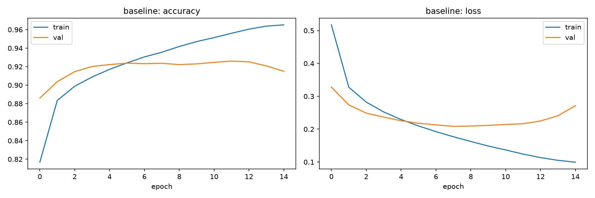
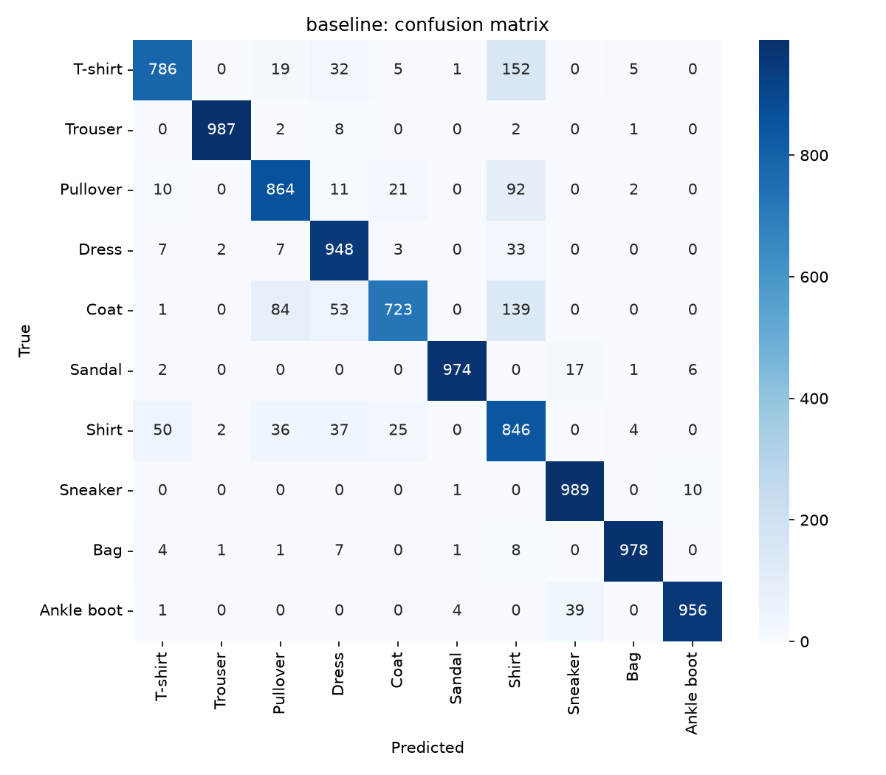

# Пункти 2-3. Базова CNN: структура, навчання, оцінка

## 2. Архітектура та аналіз model.summary()

Базова модель: два блоки Conv2D → ReLU → MaxPooling2D і класифікаційна голова
(Flatten → Dense 64 → Dense 10 з softmax). Усі згортки 3×3 з `padding="same"`.

| Шар | Розмір виходу | Параметрів | Розрахунок |
|---|---|---|---|
| Input | 28×28×1 | 0 | |
| Conv2D (32, 3×3) | 28×28×32 | 320 | 3·3·1·32 + 32 |
| ReLU | 28×28×32 | 0 | |
| MaxPooling2D (2×2) | 14×14×32 | 0 | |
| Conv2D (64, 3×3) | 14×14×64 | 18 496 | 3·3·32·64 + 64 |
| ReLU | 14×14×64 | 0 | |
| MaxPooling2D (2×2) | 7×7×64 | 0 | |
| Flatten | 3136 | 0 | 7·7·64 |
| Dense (64, ReLU) | 64 | 200 768 | 3136·64 + 64 |
| Dense (10, softmax) | 10 | 650 | 64·10 + 10 |
| **Разом** | | **220 234** (860,29 КБ) | |

Спостереження:
- `padding="same"` зберігає просторовий розмір під час згортки, а розмір зменшує лише
  MaxPooling2D (28 → 14 → 7). Кількість каналів зростає (1 → 32 → 64): мережа
  замінює просторову деталізацію на багатшу ознакову.
- Pooling і активації параметрів не мають.
- Згорткові шари разом мають лише 18 816 параметрів (8,5 %), тоді як перший Dense-шар -
  200 768 (91,2 %). Саме він найсхильніший до перенавчання і є головним кандидатом
  для Dropout (див. п. 5).

## 3. Навчання та оцінка

Умови: Adam (lr = 1e-3), batch 128, 15 епох, loss = sparse categorical crossentropy,
seed 42, поділ 55 000 / 5 000 / 10 000. Час навчання: 70,8 с.

**Криві навчання.** Train accuracy зростає до 96,5 %, а val accuracy виходить на плато
близько 92 % уже після 6-7 епох. Val loss мінімальний на 8-й епосі (0,208), після чого
зростає до 0,272, тоді як train loss далі падає (до 0,100). Це типове перенавчання:
модель починає запам'ятовувати тренувальні дані.

**Результат на тестовій вибірці:** accuracy = 0,9051, loss = 0,3032.

**Показники по класах (test):**

| Клас | Precision | Recall | F1 |
|---|---|---|---|
| T-shirt | 0,913 | 0,786 | 0,845 |
| Trouser | 0,995 | 0,987 | 0,991 |
| Pullover | 0,853 | 0,864 | 0,858 |
| Dress | 0,865 | 0,948 | 0,905 |
| Coat | 0,931 | 0,723 | 0,814 |
| Sandal | 0,993 | 0,974 | 0,983 |
| Shirt | 0,665 | 0,846 | 0,745 |
| Sneaker | 0,946 | 0,989 | 0,967 |
| Bag | 0,987 | 0,978 | 0,982 |
| Ankle boot | 0,984 | 0,956 | 0,970 |
| **Macro avg** | 0,913 | 0,905 | 0,906 |

**Аналіз.**
- Найкраще розпізнаються Trouser, Sandal, Bag, Ankle boot (F1 0,97-0,99): їхній
  силует унікальний.
- Найгірше: Shirt (F1 0,745, precision лише 0,665), Coat (recall 0,723) і T-shirt
  (recall 0,786). Низька precision класу Shirt означає, що модель часто називає
  сорочкою предмети інших класів, а низький recall Coat і T-shirt - що саме ці
  класи втрачають приклади.
- Найчастіше плутаються: <ДОПИШИ ЗА МАТРИЦЕЮ ПОМИЛОК: 2-3 пари класів і кількість,
  наприклад "T-shirt → Shirt: N зображень">.
- Ймовірна причина: у цих класів схожий силует, а відмінні деталі (комір, ґудзики,
  рукави) майже зникають на роздільній здатності 28×28.