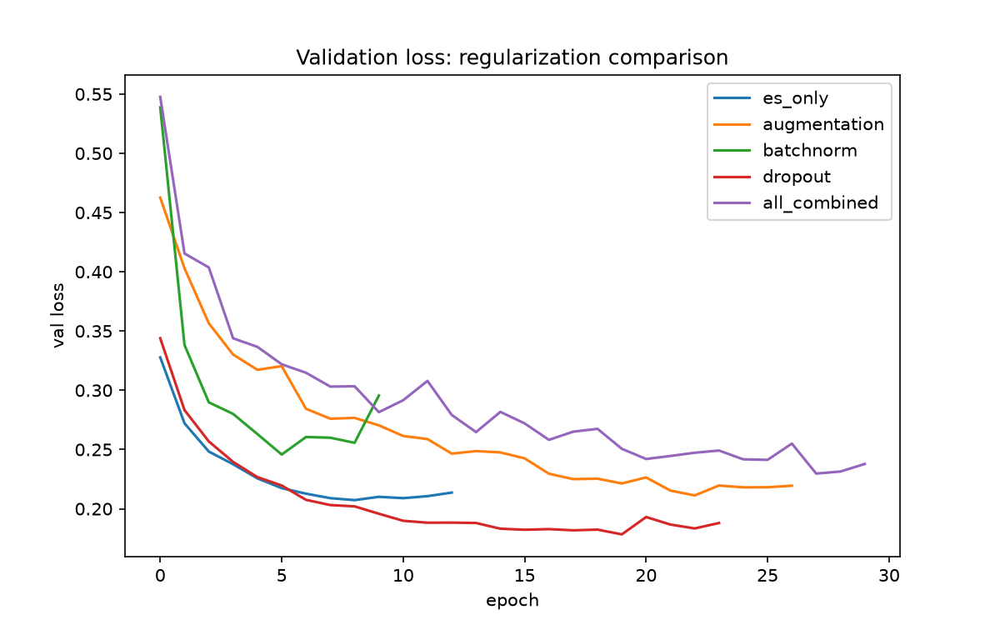

# Пункт 5. Аугментація, BatchNormalization, Dropout, рання зупинка

Умови ті самі, що в пп. 3-4: Adam (lr = 1e-3), batch 128, seed 42, однаковий поділ даних.
Відмінність: до 30 епох з ранньою зупинкою (EarlyStopping: monitor=val_loss, patience=4,
restore_best_weights=True). Архітектура: filters=(32, 64), kernel=3, MaxPooling2D, ReLU.
Кожен засіб додавався окремо, потім усі разом.

| Варіант | Параметрів | Епох | Час, с | Train acc (остання епоха) | Best val acc | Min val loss | Розрив train-val | Test acc | Test loss |
|---|---|---|---|---|---|---|---|---|---|
| baseline (п. 3, без ES) | 220 234 | 15 | 70,8 | 0,9652 | 0,9260 | 0,2084 | 0,0502 | 0,9051 | 0,3032 |
| es_only | 220 234 | 13 | 63,3 | 0,9611 | 0,9274 | 0,2073 | 0,0337 | 0,9156 | 0,2337 |
| augmentation | 220 234 | 27 | 172,1 | 0,9226 | 0,9284 | 0,2112 | -0,0014 | 0,9116 | 0,2615 |
| batchnorm | 220 522 | 10 | 94,6 | 0,9514 | 0,9156 | 0,2458 | 0,0510 | 0,9030 | 0,2795 |
| dropout 0,3 | 220 234 | 24 | 125,8 | 0,9443 | 0,9356 | 0,1784 | 0,0101 | 0,9241 | 0,2198 |
| all_combined | 220 522 | 30 | 330,0 | 0,8746 | 0,9176 | 0,2297 | -0,0386 | 0,8984 | 0,2778 |

Примітки: «остання епоха» - це епоха, на якій зупинилось навчання (після restore_best_weights
ваги повертаються до найкращої епохи, а test acc обчислено саме для них). Для варіантів
з аугментацією та Dropout train acc виміряно з увімкненими шарами випадкових перетворень,
тому розрив train-val для них занижений. Нумерація епох на графіку починається з 0.

## Висновки

**Рання зупинка** сама по собі зупинила навчання на 13-й епосі (найкраща - 9-та) і підвищила
test acc з 90,51 до 91,56 %, а test loss знизила з 0,303 до 0,234, бо повернула ваги
з моменту до початку перенавчання. Вона ще й заощадила час.

**Dropout (0,3)** - найкращий окремий засіб: найнижчий val loss (0,178), найвища val acc (93,6 %)
і test acc (92,41 %), розрив train-val зменшився з 3,4 до 1,0 п. п. Це логічно: 91 % параметрів
зосереджено в першому Dense-шарі, саме на нього діє Dropout.

**Аугментація** прибрала розрив train-val (train acc нижча за val), але навчання
сповільнилося: 27 епох і 172 с. За test acc (91,16 %) вона не перевершила рання зупинку.
Горизонтальне віддзеркалення, обертання й масштаб лише частково відповідають природі
зображень одягу, і малій мережі важко підлаштуватися під такі варіації.

**BatchNormalization** прискорила початок навчання (84 % train acc вже на 1-й епосі),
але перенавчання не зменшила: val loss нестабільний і зростає після 6-ї епохи, розрив
train-val найбільший (5,1 п. п.), test acc нижча (90,30 %). У цій конфігурації BatchNorm
не допомогла.

**Комбінація всіх засобів** не дала найкращого результату: модель недонавчена (train acc 87,5 %
нижча за val acc 91,3 %, ES не спрацювала за 30 епох), test acc 89,84 %. Три сильні
регуляризатори для мережі з ~220 тис. параметрів - надмірно.

**Підсумок.** Перенавчання зменшили рання зупинка й особливо Dropout. Аугментація
усунула розрив, але не покращила тест, а BatchNorm і комбінація не допомогли.
Клас Shirt лишається найгіршим у всіх варіантах (F1 0,70-0,77), тож його причина - низька
роздільна здатність 28×28, а не перенавчання. Кожен варіант запускався один раз, похибка
test acc ≈ ±0,3 п. п., тому надійно відрізняється лише перевага Dropout (+0,85 п. п. і
менший test loss).