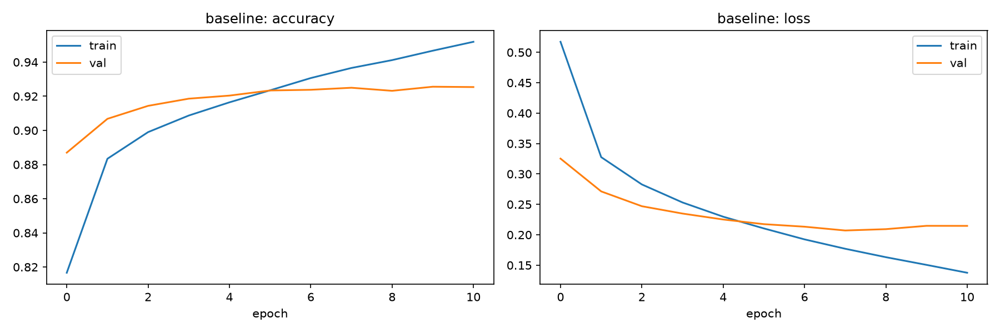
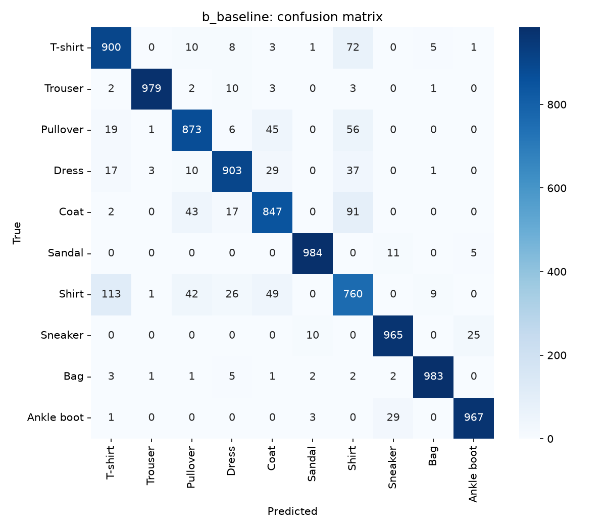

# Частина b. Автоматизована оптимізація архітектури CNN (KerasTuner)

## Пункт 1. Умови порівняння та базова модель

Щоб порівняння з базовою CNN було коректним, усі експерименти частини b виконано за тих самих умов, що й у частині a:

| Умова | Значення |
|---|---|
| Набір даних | Fashion-MNIST (70 000 зображень 28×28, 10 класів) |
| Поділ вибірок | train 55 000 / val 5 000 / test 10 000 (однаковий для всіх моделей) |
| Нормалізація | піксели / 255 → діапазон [0, 1] |
| Розмір батча | 128 (430 кроків на епоху) |
| Оптимізатор / loss | Adam / sparse categorical crossentropy |
| Рання зупинка | за `val_loss`, patience = 3, `restore_best_weights=True` |
| Зерно генератора | 42 (`keras.utils.set_random_seed`) |

Тестова вибірка не використовувалась ні для навчання, ні для вибору гіперпараметрів: усі рішення приймались за валідаційними даними.

### Архітектура базової CNN

Conv2D(32, 3×3) → ReLU → MaxPool(2×2) → Conv2D(64, 3×3) → ReLU → MaxPool(2×2) → Flatten → Dense(64, ReLU) → Dense(10, softmax).

Усі згортки з `padding="same"`. Кількість параметрів: 320 + 18 496 + 200 768 + 650 = **220 234**. Основна частина (≈ 91 %) припадає на повнозв'язний шар Dense(64) після Flatten (3136 → 64).

### Показники базової моделі

| Показник | Значення |
|---|---|
| Кількість параметрів | 220 234 |
| Val accuracy (найкраща) | 92,56 % |
| Test accuracy | **91,61 %** |
| Test loss | **0,2330** |
| Кількість епох до зупинки | 11 (з максимальних 15) |
| Час навчання | 122,9 с |

**Аналіз кривих.** Точність на навчальній вибірці стабільно зростає й наприкінці досягає ≈ 95,2 %, тоді як валідаційна виходить на плато ≈ 92,5 % уже з 6–8-ї епохи. Функція втрат на валідації мінімальна на 8-й епосі (0,207), після чого дещо зростає (до 0,215), а втрати на навчанні й далі падають (до 0,138). Розрив між train і val ≈ 2,7 в.п. за точністю та ≈ 0,08 за loss свідчить про початок **перенавчання**: модель без регуляризації запам'ятовує навчальні дані. Рання зупинка спрацювала на 11-й епосі, тобто рівно через 3 епохи після найкращої.

**Аналіз матриці помилок.** Найкраще розпізнаються взуття, сумки й штани: Sandal (98,4 %), Bag (98,3 %), Trouser (97,9 %), Ankle boot (96,7 %), Sneaker (96,5 %). Найгірше — верхній одяг: **Shirt (recall 76,0 %, F1 = 0,752)**, Coat (84,7 %), Pullover (87,3 %). Головна помилка — плутанина Shirt ↔ T-shirt (113 сорочок визнано футболками, 72 футболки — сорочками), а також Shirt ↔ Coat/Pullover. Ці класи схожі за силуетом на роздільності 28×28, тому саме вони є «вузьким місцем» моделі й орієнтиром для оцінки покращень від автоматичного підбору гіперпараметрів.
